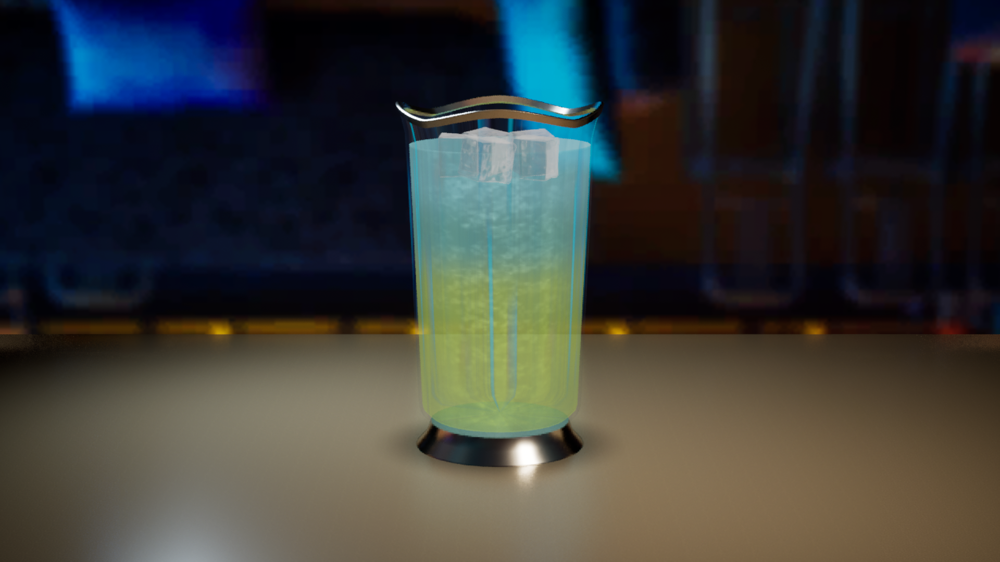
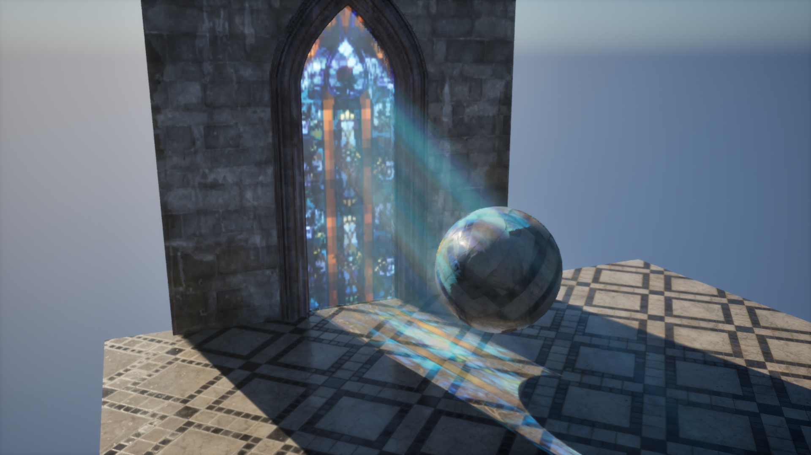
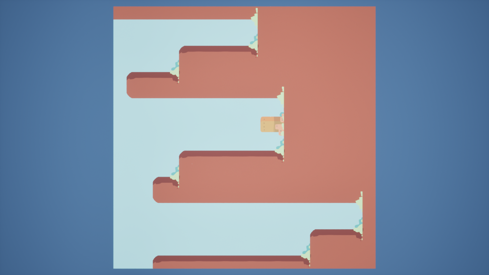
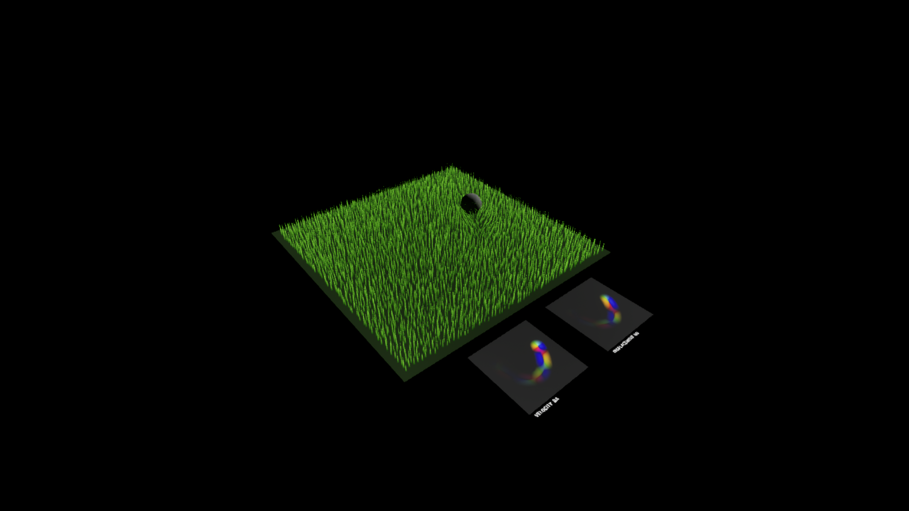

# UnrealPlayGround

Unreal Engine 5.6 · 图形渲染与程序化生成实验

## 调酒

原杯体与冰块资产，结合分层液体、细密气泡、倒入与搅拌动画，呈现吧台环境中的玻璃与液体质感。

## 彩窗

沿主光方向投射彩窗图案，结合深度遮挡与光束，让色彩落在建筑与场景物体上。

## WFC

通过图块邻接约束与坍缩生成二维地图，并探索不规则网格建造与 Marching Squares 模块拼接。

## 交互草地

GPU 弹簧模拟驱动草叶弯曲与回弹，支持动态施力，并可视化位移和速度状态。

