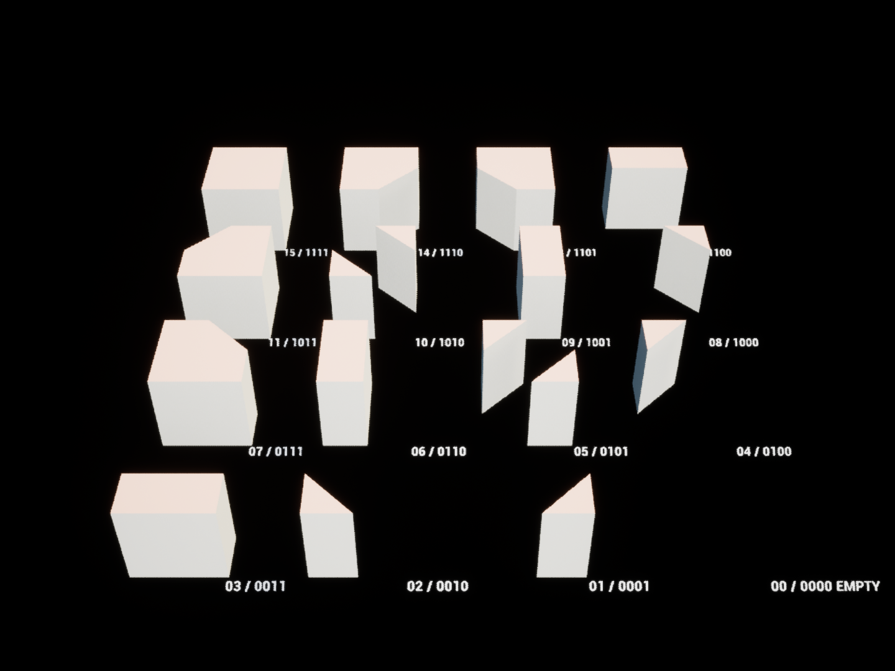

# UnrealPlayGround

**Unreal Engine 5.6 · C++ · HLSL · Rendering & Procedural Generation**

个人技术美术与图形实验工程。收录分层调酒、彩窗投射、WFC 程序化生成与草地交互四组可运行 Demo，代码、Shader、原始演示资产和关卡放在同一个仓库中。

每个效果使用独立插件与独立资产目录。彩窗、WFC 和草地保留原 UE demo 的场景与资产；调酒导入 Unity 原 FBX、贴图与材质参数，并用 UE C++ / 材质重新实现运行逻辑。

| 分层调酒 | 彩窗投射 |
| --- | --- |
|  |  |
| [实现与操作](Plugins/Bartending/README.md) | [实现与操作](Plugins/StainedGlass/README.md) |
| **GPU 草地交互** | **WFC 程序化生成** |
|  |  |
| [实现与操作](Plugins/GrassInteraction/README.md) | [实现与操作](Plugins/WFC/README.md) |

## 快速开始

1. 安装 **Unreal Engine 5.6**、Visual Studio 2022 与 C++ 游戏开发工具链。本工程在 Windows / DX12 / SM6 上验证。
2. 克隆仓库，右键 `UnrealPlayGround.uproject`，生成项目文件。源码版引擎用户先使用 **Switch Unreal Engine version** 选择自己的 5.6 引擎。
3. 编译 **UnrealPlayGroundEditor / Development Editor / Win64**，打开工程。
4. 在下表选择关卡，点击 **Play**，点击游戏视口使其获得输入焦点。默认打开调酒场景。

```powershell
git clone https://github.com/junyangtong/UnrealPlayGround.git
# 按本机引擎安装位置修改以下路径
& '<UE_5.6>/Engine/Build/BatchFiles/Build.bat' UnrealPlayGroundEditor Win64 Development '-Project=<project>/UnrealPlayGround.uproject' -WaitMutex
```

仓库包含迁移后的 `.uasset` 和 `.umap`，正常使用不需要先运行 Python。首次打开仍需等待 UE 编译 Shader。

| 演示 | 关卡（Content Browser 路径） | 操作入口 |
| --- | --- | --- |
| 分层调酒 | `/Game/Demos/Bartending/Maps/L_Bartending` | `R` 清空，`1–5` 倒入，空格搅拌，`I` 浮冰 |
| 彩窗投射 | `/Game/Demos/StainedGlass/Maps/L_StainedGlass` | Play 后观察；调整 Projector 与主方向光 |
| GPU 草地交互 | `/Game/Demos/Grass/Maps/L_GrassInteraction` | 空格切换自动施力，左键施力，`R` 清零 |
| 二维 WFC | `/Game/Demos/WFC/Maps/L_WFC` | Details 中 `Generate` / `Regenerate`，编辑 Seed 与 TileSet |
| 城镇建造原型 | `/Game/Demos/WFC/Town/L_TownPrototype` | 左/右键增减层，中键旋转，滚轮缩放，`Z/Y` 撤销重做 |
| Marching Squares | `/Game/Demos/WFC/MarchingSquares/L_MarchingSquares` | 点击顶点改变占用，观察模块拼接 |
| 16 种模型展示 | `/Game/Demos/WFC/MarchingSquares/L_SquareModelGallery` | 编辑器中查看四角编码与模型对应关系 |

## 01 · 分层调酒

将 [Unity 调酒实验](https://github.com/junyangtong/JY_ToonProject) 的分层数据和动画思路改写为 UE 原生 Demo。

- 五个等高度液体层，独立 RGBA、气泡强度、过渡范围、边界扰动与可选细节遮罩。
- 平滑倒入与搅拌动画；搅拌保持总液量，颜色、气泡和遮罩权重向平均值过渡。
- 原 Cup / Liquid / Ice FBX 模型；按原液体网格轮廓裁剪并封闭液面，保留侧面 UV 与法线。原 Bubble、Mask、Noise、MatCap 和环境贴图参与材质计算。
- `PourLayer`、`Stir`、`ResetDrink` 等蓝图接口，可替换示例键盘输入。

入口：[Actor 与状态控制](Plugins/Bartending/Source/Bartending/Private/BartendingDemo.cpp) · [液体 HLSL](Plugins/Bartending/Shaders/LayeredLiquid.hlsl) · [完整说明](Plugins/Bartending/README.md)

此版本使用 UE 透明材质、固定排序和真实网格液面。Unity 的多 RT 深度合成、任意容器、倾倒溢出与真实流体求解不在本 Demo 范围内；透明交叠及冰块穿出液面的排序仍是近似。

## 02 · 彩窗投射

将窗户纹理沿方向光投射到场景几何，结合深度遮挡与光束表现。

- 从窗户坐标系构建斜投影矩阵与投影体网格。
- 通过透明表面后的世界坐标重建接收点，采样彩窗图案。
- 正交 SceneCapture 记录光空间深度，减少光照穿过遮挡物的问题。
- 96 步屏幕射线采样表现光束，投影矩阵与参数由 C++ 更新。

保留原哥特式彩窗、建筑墙面、地板、投射器蓝图以及场景实际依赖的材质和贴图。材质 Custom 节点随 `.uasset` 一起迁移。

入口：[投射器 C++](Plugins/StainedGlass/Source/StainedGlass/Private/StainedGlassProjector.cpp) · [原材质资产](Content/Demos/StainedGlass/Materials) · [完整说明](Plugins/StainedGlass/README.md)

## 03 · WFC 与建造实验

二维 WFC 包含最小候选集选择、加权坍缩、四方向 Socket 约束传播与矛盾重试，并提供图集切割和规则编辑工具。示例使用原 Tile 图集、切片、TileSet 数据资产和生成器蓝图。

城镇实验进一步包含六边形点阵、三角形合并、不规则四边形平滑、挤出建造、拾取和撤销重做。Marching Squares 使用四角占用编码匹配 16 种情况，并将模型变形到不规则四边形。



**当前二维 WFC 求解器与城镇/Marching Squares 原型是独立实验。城镇尚未接入 WFC 选模，也未实现三维 Marching Cubes。**

入口：[WFC 求解器](Plugins/WFC/Source/WFCRuntime/Private/WFCSolver.cpp) · [城镇网格](Plugins/WFC/Source/WFCRuntime/Private/WFCTownGrid.cpp) · [完整说明](Plugins/WFC/README.md)

## 04 · GPU 草地交互

- 两张 `128 × 128 RGBA16f` Render Target 交替读写，分别保存前后两步状态。
- `RG` 保存 XY 偏移，`BA` 保存 XY 速度；每个像素是一根二维弹簧。
- Compute Shader 按 `1/120 s` 固定步长积分，材质 WPO 按草高权重弯曲草片。
- 4096 簇程序化交叉草片，以及偏移、速度两块调试面板。

```text
状态 A → 弹簧 Compute Shader → 状态 B
             每步交换 A/B          ↓
                           草材质 WPO → 草梢弯曲
```

入口：[弹簧 Compute Shader](Plugins/GrassInteraction/Shaders/GrassSpring.usf) · [WPO](Plugins/GrassInteraction/Shaders/GrassWPO.hlsl) · [完整说明](Plugins/GrassInteraction/README.md)

## 目录约定

```text
UnrealPlayGround/
├─ UnrealPlayGround.uproject
├─ Config/                       最小工程配置
├─ Source/UnrealPlayGround/       主模块
├─ Plugins/
│  ├─ Bartending/                Source、Shaders、Scripts、ArtSource、Reference/Unity
│  ├─ StainedGlass/              彩窗投射器 C++
│  ├─ GrassInteraction/          草地：Source、Shaders、Scripts
│  └─ WFC/                      Runtime、Editor、Scripts
├─ Content/Demos/
│  ├─ Bartending/               Maps、Materials、Meshes、Textures
│  ├─ StainedGlass/             Maps、Blueprints、Meshes、Materials、Textures
│  ├─ Grass/                    Maps、Materials
│  └─ WFC/                      Maps、Blueprints、Data、Materials、Textures、Town、MarchingSquares
├─ Scripts/                     资产检查、截图工具
└─ Docs/Images/                 本工程实际运行截图
```

一个效果的素材放回自己的目录；WFC 按二维拼图、城镇和模块库再分组。`Binaries`、`Intermediate`、`Saved`、DDC 和 IDE 缓存不进入版本控制。

## 资产来源与验证

- UE 部分迁移了 125 个原资产及其场景依赖，重新组织到 `Content/Demos`。未引用 `Common`。
- Unity 调酒模型和贴图源文件位于 `Plugins/Bartending/ArtSource`；原材质、Prefab、脚本与自定义 Shader 位于 `Reference/Unity`，便于对照移植。
- Unity `.mat`、Prefab 和 URP RenderPass 不能作为 UE 运行资产直接使用。当前 UE 版本已接入原模型与贴图，但尚未复刻 Unity 多 RT 深度合成，因此**不宣称画面完全一致**。
- 关卡和材质已保存，打开工程即可使用。调酒的 `Scripts/create_bartending_demo.py` 会重建调酒材质并重新绑定场景，执行前请提交自己的修改。

已验证：Win64 Development Editor 编译通过，6 项自动化测试通过，159 个资产 / 7 个关卡依赖检查通过。参见 [验证摘要](Docs/Validation.json) 和 [原资产迁移清单](Docs/AssetMigration.json)。

自动化测试入口：

```text
Automation RunTests Bartending
Automation RunTests GrassInteraction.Spring
Automation RunTests WFC.Town
```

`Scripts/audit_assets.py` 检查项目资产的硬/软引用；`Scripts/capture_demos.py` 在独立编辑器中运行并截图，结束后退出该编辑器。验证报告与日志写入 `Saved`，不上传缓存和本机日志。

本项目以学习和效果展示为目的。引擎基础资源随 Unreal Engine 提供；迁移代码的既有许可通知保留在 [LICENSES](LICENSES/UE-Demo-MIT.txt)。
